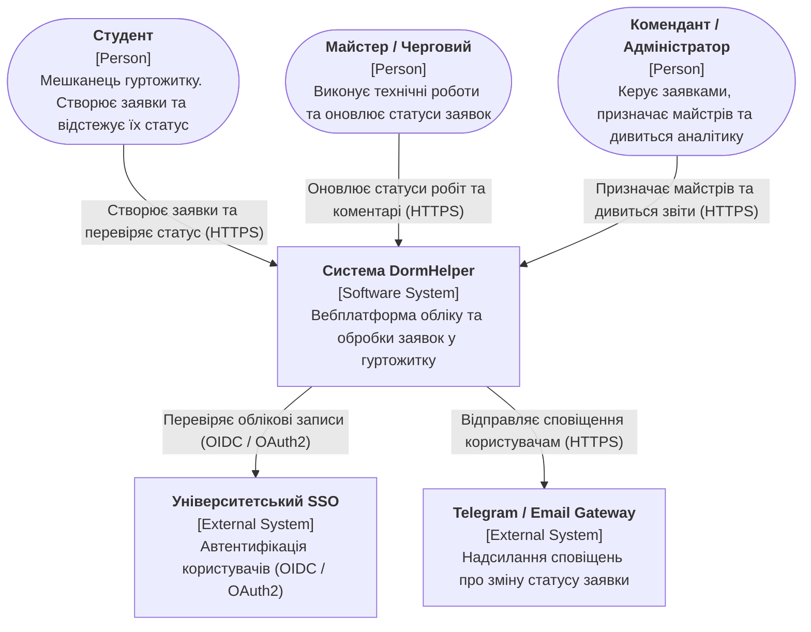
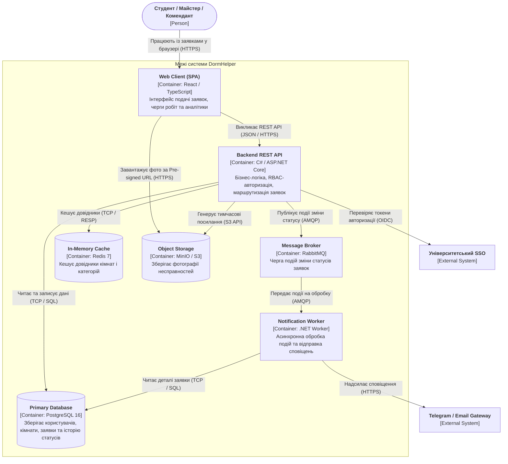
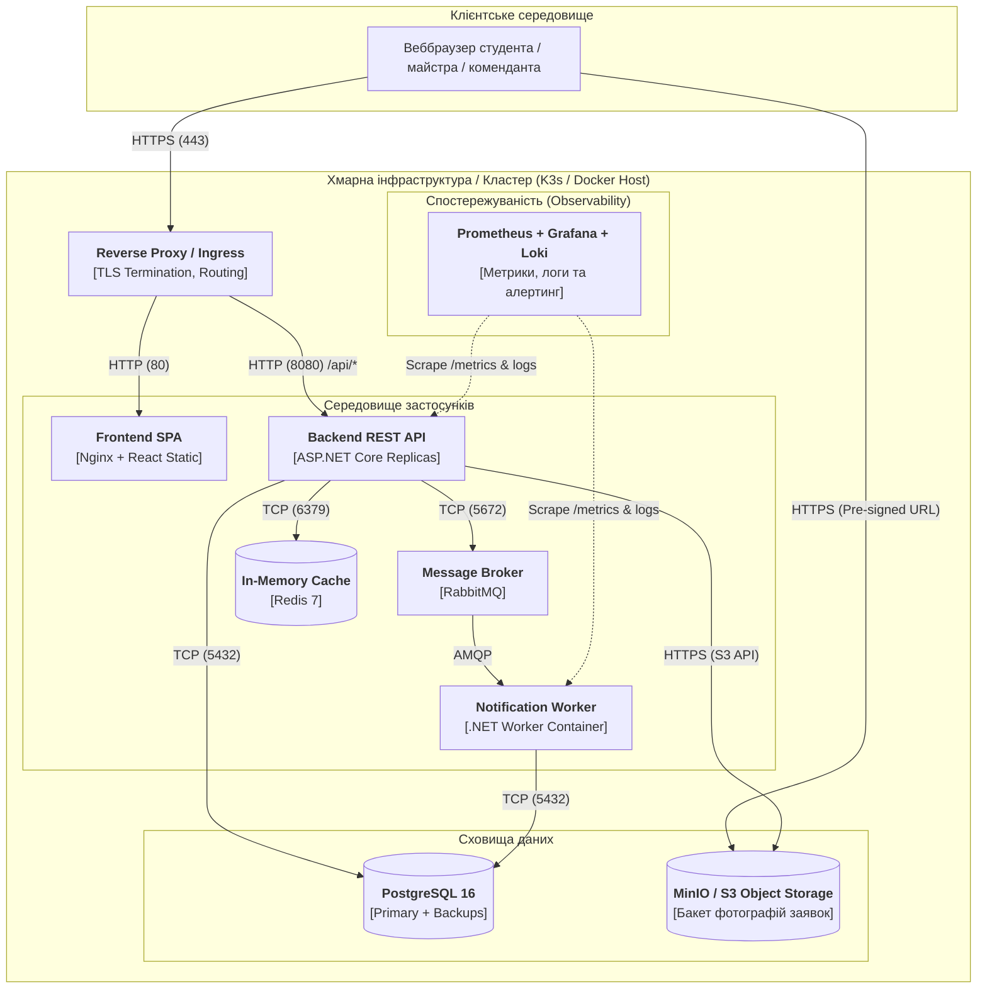

# Лабораторна робота №1: Аналіз, вимоги, життєвий цикл та архітектурне бачення
Проєкт: DormHelper — Інформаційна система обліку та обробки заявок на технічне обслуговування і ремонт у студентському гуртожитку.

---

## 1. Формування вимог

### 1.1. Опис бізнес-ідеї
Проблема: У студентському гуртожитку заявки на ремонт (несправна сантехніка, вибиті автомати/електрика, збої локальної мережі, поломка меблів чи видача інвентарю) зазвичай подаються хаотично: у приватних Telegram-чатах, на словах черговому на вахті або в паперовому журналі. Через це звернення губляться, пріоритети незрозумілі, студенти не бачать статусу своєї заявки, а комендант гуртожитку не має об'єктивної статистики несправностей і навантаження на майстрів.

Рішення: Вебпортал DormHelper, який забезпечує централізований прийом, маршрутизацію та контроль виконання заявок у гуртожитку. Студент створює заявку із зазначенням кімнати, категорії та фотографії проблеми, майстер або комендант бере її в роботу та оновлює статус, а система зберігає повну історію робіт та формує аналітику по блоках і типах поломок.

### 1.2. Функціональні вимоги (User Stories)

#### Роль: Студент (Мешканець гуртожитку)
- US-01 (Авторизація): Як студент, я хочу авторизуватися через корпоративну пошту університету (SSO / OAuth2), щоб система автоматично підтягувала мій гуртожиток та номер кімнати.
- US-02 (Створення заявки): Як студент, я хочу створити заявку з описом проблеми, вибором категорії (сантехніка, електрика, мережа, меблі/інше), пріоритету та фотографією, щоб майстер заздалегідь розумів характер несправності.
- US-03 (Відстеження статусу): Як студент, я хочу переглядати список своїх заявок і їхній поточний статус (*Створено*, *Призначено*, *У роботі*, *Очікує деталей*, *Виконано*, *Відхилена*) та отримувати сповіщення про зміни.
- US-04 (Підтвердження виконання): Як студент, я хочу підтвердити закриття заявки після ремонту або повернути її на доопрацювання та залишити оцінку якості роботи.

#### Роль: Майстер / Черговий технік
- US-05 (Черга завдань): Як майстер, я хочу бачити призначені мені або відкриті заявки за своєю спеціалізацією та пріоритетом, щоб планувати маршрут обходу кімнат.
- US-06 (Оновлення статусу та коментарі): Як майстер, я хочу змінювати статус заявки, додавати технічні коментарі (наприклад, *«потрібна заміна змішувача»*) та фіксувати витрачені матеріали.

#### Роль: Комендант / Адміністратор гуртожитку
- US-07 (Управління заявками та виконавцями): Як комендант, я хочу переглядати всі заявки по гуртожитку, призначати відповідальних майстрів і підвищувати пріоритет аварійних інцидентів.
- US-08 (Аналітика та довідники): Як комендант, я хочу переглядати звіти за категоріями поломок і середнім часом виконання заявок, а також оновлювати довідники кімнат і виконавців.

---

## 2. Нефункціональні вимоги (НФВ / NFR) та їхній вплив на DevOps

Нефункціональні вимоги безпосередньо визначають архітектуру інфраструктури та інструменти DevOps-інженера:

| Категорія НФВ | Опис вимоги та цільові метрики | Вплив на архітектуру та вибір DevOps-інструментів |
| :--- | :--- | :--- |
| 1. Масштабованість (Scalability) | Навантаження на систему має хвильовий характер: під час поселення та початку семестру трафік зростає у $8\text{--}10$ разів (до $1200$ активних мешканців, пікова швидкість запитів — до $120\text{ RPS}$), а також спостерігаються щоденні вечірні піки ($19:00\text{--}23:00$). | • Контейнеризація та оркестрація: Використання Docker та Kubernetes (K8s / K3s) з налаштованим *Horizontal Pod Autoscaler (HPA)* за метриками CPU/RAM. • Stateless-архітектура: Винесення фотографій несправностей у об'єктне сховище MinIO / S3, щоб репліки бекенду залишалися безстановими та масштабувалися миттєво. • Кешування: Використання Redis для кешування довідників кімнат, категорій та частих запитів списку заявок. |
| 2. Доступність та надійність (Availability) | Рівень доступності сервісу має становити $SLA \ge 99.5\%$ (допустимий простій не більше $3.65$ год/місяць). Втрата зареєстрованих заявок та фотофіксації неприпустима ($RPO < 1\text{ год}$, $RTO < 30\text{ хв}$). | • База даних: Кластер PostgreSQL 16 у конфігурації Primary-Replica з автоматичним перемиканням (Failover). • Zero-Downtime Deployment: Використання стратегії *RollingUpdate* під час викатки нових релізів через GitHub Actions. • Резервне копіювання: Автоматизовані щоденні снепшоти БД та версіонування бакетів у MinIO / S3. |
| 3. Безпека (Security) | Доступ до системи мають лише верифіковані мешканці та персонал гуртожитку за протоколом HTTPS ($TLS\ 1.3$). Реалізується рольове розмежування прав доступу (RBAC: Студент, Майстер, Комендант) та перевірка завантажених зображень. | • Валідація файлів та RBAC: Перевірка MIME-типів і розміру фото на рівні API та обмеження доступу до чужих заявок. • DevSecOps у CI/CD: Автоматичне сканування коду (ESLint / Hadolint), залежностей та Docker-образів (Trivy) на вразливості. • Секрети та мережа: Зберігання паролів і ключів у K8s Secrets / GitHub Secrets, випуск TLS-сертифікатів через cert-manager (Let's Encrypt). |
| 4. Спостережуваність (Observability) | Час відповіді API для $95\%$ запитів не має перевищувати $p_{95} \le 250\text{ мс}$. Команда повинна бачити стан черги сповіщень та отримувати алерти про помилки $5\text{xx}$ за $\le 1\text{ хв}$. | • Метрики та алертинг: Збір метрик інфраструктури та додатку за допомогою Prometheus, візуалізація у Grafana, сповіщення в Telegram через Alertmanager. • Централізоване логування: Стек Grafana Loki для збору структурованих логів з усіх контейнерів. • Трейсинг: OpenTelemetry для відстеження затримок між API, БД та S3. |

---

## 3. Життєвий цикл та методологія розробки

### 3.1. Перехід від класичних моделей (Waterfall / RUP) до Agile + DevOps
У класичних методологіях, таких як каскадна модель (Waterfall) або традиційний Rational Unified Process (RUP), життєвий цикл поділявся на послідовні фази (*Inception, Elaboration, Construction, Transition*).
- Недоліки RUP для системи DormHelper: Розробники (Dev) тривалий час реалізовували б функціонал у фазі *Construction*, після чого передавали б артефакти системним адміністраторам (Ops) на фазі *Transition*. Це створювало «стіну непорозуміння»: розбіжності в налаштуваннях середовищ, міграціях бази даних або правах доступу до сховища файлів виявлялися занадто пізно, а зміни в логіці статусів заявок потребували довгого циклу узгоджень.

### 3.2. Обрана методологія: Agile (Scrum) з інтеграцією DevOps
Для розробки DormHelper обрано ітеративну методологію Scrum (тривалість спринту — 2 тижні) у поєднанні з практиками DevOps та Continuous Delivery (Безперервна доставка):

1. Plan & Design (Architecture as Code): На початку спринту нові вимоги та зміни архітектури фіксуються у вигляді коду (Mermaid/Structurizr DSL) та ADR безпосередньо в Git-репозиторії.
2. Code & Shift-Left Testing: Розробники працюють у коротких гілках (*Feature Branches* / *GitHub Flow*). Локальне середовище повністю ідентичне продакшену завдяки docker-compose.
3. Continuous Integration (CI): При кожному *Pull Request* автоматично запускається пайплайн (GitHub Actions):
   - Лінтери та статичний аналіз коду (ESLint, Hadolint).
   - Юніт- та інтеграційні тести (з підняттям тестової PostgreSQL у контейнері).
   - Збірка Docker-образу та його сканування на вразливості (Trivy).
4. Continuous Delivery / Deployment (CD):
   - Після злиття в гілку main образ публікується в Container Registry (GHCR).
   - Інфраструктура описується декларативно (Infrastructure as Code — Docker Compose / Helm-чарти).
   - Оновлення автоматично розгортаються на *Staging*, а після перевірки працездатності (Healthchecks / Smoke Tests) — на *Production*.
5. Operate & Monitor: Зворотний зв'язок із Prometheus/Grafana дозволяє команді відстежувати реальне навантаження під час поселення студентів та планувати оптимізації на наступний спринт.

---

## 4. Архітектурне проєктування (Модель C4 та 4+1 Deployment View)

> Примітка: Діаграми нижче описані за допомогою Mermaid.js відповідно до підходу *Architecture as Code (AaC)*. Також у репозиторії міститься файл architecture.dsl для генерації діаграм через Structurizr.

### 4.1. C4 Рівень 1: Контекстна діаграма системи (System Context)
Показує систему DormHelper у центрі та її взаємодію з користувачами й зовнішніми сервісами.

---

### 4.2. C4 Рівень 2: Діаграма контейнерів (Container Diagram)
Розкриває внутрішню будову системи DormHelper на рівні окремо розгортуваних одиниць (контейнерів).

---

### 4.3. Модель 4+1: Фізичний вигляд / Вигляд розгортання (Deployment View)
Показує, як програмні контейнери мапляться на хмарну інфраструктуру та кластер з урахуванням вимог масштабованості, безпеки та observability.

---

## 5. Журнал архітектурних рішень (Architecture Decision Records)

Усі архітектурні рішення зберігаються у каталозі docs/adr/:
1. [ADR-0001: Гібридна архітектура зберігання даних (PostgreSQL + S3 Object Storage)](docs/adr/adr_0001.md)
2. [ADR-0002: Асинхронна обробка сповіщень через RabbitMQ та фоновий воркер](docs/adr/adr_0002.md)
