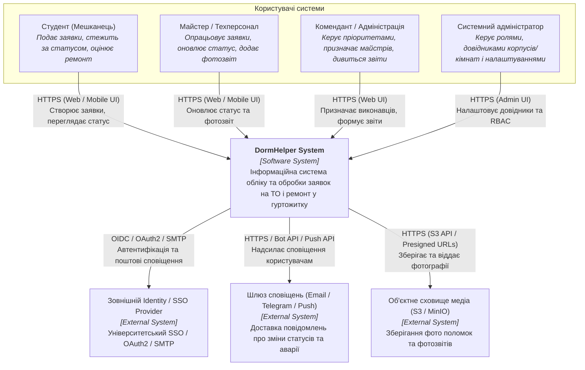
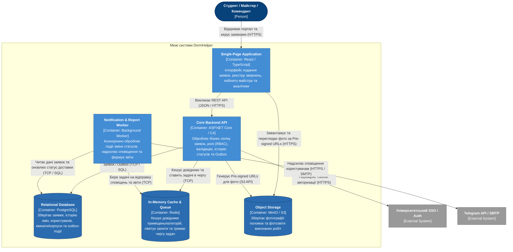
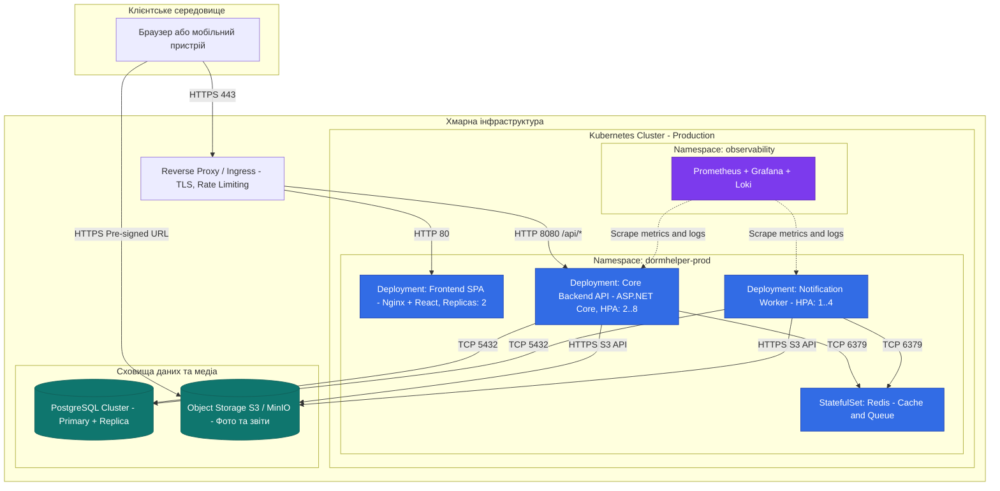

# Лабораторна робота №1: Аналіз, вимоги, життєвий цикл та архітектурне бачення

# DormHelper — Інформаційна система обліку та обробки заявок на технічне обслуговування і ремонт у студентському гуртожитку

---

## 1. Бізнес-ідея та функціональні вимоги (User Stories)

### Бізнес-ідея
У студентських гуртожитках процеси подання та опрацювання заявок на ремонт (сантехніка, електрика, опалення, меблі, замки, мережева інфраструктура в кімнатах і місцях загального користування) часто відбуваються через розрізнені чати, паперові журнали на вахті або усні звернення. Через це заявки губляться, пріоритети аварійних ситуацій визначаються із затримкою, студенти не бачать статусу виконання, а адміністрація й комендант не мають аналітики щодо типових поломок, термінів ремонту та завантаженості майстрів.

**DormHelper** — централізована веб- та мобільно-адаптивна інформаційна система для автоматизації життєвого циклу заявок на технічне обслуговування і ремонт у студентському гуртожитку. Система об'єднує **студентів (мешканців)**, **майстрів/технічний персонал**, **коменданта/адміністрацію гуртожитку** та **зовнішні сервіси сповіщень/автентифікації**, забезпечуючи прозорий трекінг статусів, пріоритизацію інцидентів, фотофіксацію проблем і звітності.

### Базовий набір функціональних вимог (User Stories)

| ID | Роль | Функціональна вимога (User Story) | Критерії приймання (Acceptance Criteria) | Пріоритет |
| :--- | :--- | :--- | :--- | :--- |
| **US-01** | Студент | Як мешканець гуртожитку, я хочу швидко створити заявку на поломку із зазначенням локації (корпус, блок/поверх, кімната або зона загального користування), категорії, опису та фото, щоб проблема була зафіксована. | Заявка отримує унікальний номер, статус `New`, зберігаються фото та метадані локації; обов'язкові поля валідуються. | Must Have |
| **US-02** | Студент | Як студент, я хочу переглядати історію своїх заявок і отримувати сповіщення при зміні статусу (призначення майстра, вихід на роботу, завершення, відхилення), щоб розуміти терміни вирішення. | Зміна статусу генерує подію та надсилає push/email/bot-сповіщення; у картці заявки відображається таймлайн змін. | Must Have |
| **US-03** | Студент | Як студент, я хочу оцінити якість виконаного ремонту та залишити коментар після закриття заявки, щоб адміністрація могла контролювати сервіс. | Оцінка (1–5) та коментар доступні для заявок у статусі `Resolved`; при низькій оцінці формується сигнал для перевірки комендантом. | Should Have |
| **US-04** | Комендант / Адміністратор | Як комендант/адміністратор, я хочу бачити єдиний реєстр заявок із фільтрацією за корпусом, статусом, категорією та пріоритетом (`Critical`, `High`, `Medium`, `Low`) і призначати виконавця, щоб оперативно реагувати на аварії. | Критичні заявки підсвічуються та піднімаються вгору списку; призначення майстра переводить заявку у `Assigned`. | Must Have |
| **US-05** | Майстер (Сантехнік / Електрик / Столяр) | Як майстер, я хочу бачити свій змінний/щоденний список призначених заявок, оновлювати їхні статуси (`In Progress`, `Blocked/Waiting Parts`, `Resolved`) та додавати фотозвіт/коментар про витрачені матеріали. | Майстер бачить лише призначені йому або відкриті у його спеціалізації заявки; перехід у `Resolved` вимагає коментаря або фотозвіту. | Must Have |
| **US-06** | Комендант / Адміністратор | Як керівник гуртожитку, я хочу формувати звіти за період щодо кількості заявок, середнього часу реакції (MTTR) та найчастіших поломок за блоками/категоріями, щоб планувати закупівлі та профілактику. | Звіт формується за обраний діапазон дат і підрозділ з можливістю експорту в CSV/PDF. | Could Have |
| **US-07** | Адміністратор системи | Як адміністратор, я хочу керувати ролями користувачів (RBAC), довідниками корпусів/кімнат/категорій робіт і розкладом змін майстрів, щоб система відповідала актуальній структурі гуртожитку. | Зміни ролей і прав застосовуються негайно з фіксацією в audit log; неавторизовані запити повертають `401/403`. | Must Have |

---

## 2. Нефункціональні вимоги (NFR) та їхній вплив на DevOps

Нефункціональні вимоги задають інженерні обмеження, які безпосередньо визначають вибір інфраструктури, пайплайнів CI/CD, засобів моніторингу та відмовостійкості:

| Категорія NFR | Цільовий показник / Вимога | Як це диктує інфраструктурні та DevOps-рішення |
| :--- | :--- | :--- |
| **Масштабованість (Scalability)** | Підтримка пікових сплесків звернень (заселення на початку семестру, опалювальний сезон, масові аварії водопостачання/електрики) — до 500–1 500 одночасних активних сесій і сплесків до 100+ заявок/хв без деградації API (`p95 < 300 мс` для читання/створення заявок). | Контейнеризація сервісів (Docker), горизонтальне масштабування stateless API та worker-нод за метриками CPU/RPS/черги (Kubernetes HPA або автоскейлінг хмарної платформи), винесення медіафайлів в об'єктне сховище (S3/MinIO) замість локального диска контейнера. |
| **Доступність (Availability)** | Цільовий SLA `99.5%`–`99.9%` у робочий час і під час аварійних подій; планові оновлення без зупинки обслуговування (zero-downtime deployments). | Rolling update / Blue-Green стратегії розгортання в CI/CD, health/readiness probes (`/health/live`, `/health/ready`), реплікація БД (Primary + Read Replica або керований кластер БД з автоматичним failover) та щоденні автоматичні бекапи з перевіркою відновлення. |
| **Безпека (Security)** | Захист персональних даних мешканців (ПІБ, кімната, контакти), розмежування доступу (RBAC: `Student`, `Technician`, `Commandant`, `Admin`), шифрування трафіку (`TLS 1.2/1.3`) і паролів/токенів, захист від OWASP Top 10 (SQLi, XSS, IDOR, брутфорс). | Секрети та ключі підписання токенів зберігаються у Secret Manager / CI/CD masked variables (не в Git), автоматичне SAST/SCA/container image сканування у CI pipeline (наприклад, Trivy / Semgrep), rate limiting на reverse proxy/API gateway, перевірка прав власності на рівні сервісів (захист від IDOR). |
| **Спостережливість (Observability)** | Повна прозорість стану системи: метрики продуктивності й черг, структуровані логи з `correlationId`/`traceId`, алертинг при помилках `5xx`, затримках обробки заявок або збоях розсилки сповіщень. | З першого комміту впроваджується структуроване логування (JSON з `traceId`), експорт метрик у форматі Prometheus (`/metrics`), збір трейсів (OpenTelemetry), дашборди в Grafana та правила сповіщень (Alertmanager/Telegram/Email) для чергової команди. |
| **Зручність супроводу та відтворюваність (Maintainability & IaC)** | Ідентичність середовищ `dev`, `staging`, `prod`; швидкий розворот і відкат релізу (MTTR відновлення після невдалого деплою `< 10 хв`). | Уся інфраструктура та конфігурації описуються як код (IaC / Docker Compose / Helm / Terraform), автоматизовані міграції БД у релізному пайплайні з можливістю відкату, обов'язкові unit/integration тести та smoke-перевірки перед перемиканням трафіку. |

---

## 3. Життєвий цикл та методологія

### Обрана методологія: Agile (Scrum) + DevOps
Для розробки **DormHelper** обрано ітеративно-інкрементальний підхід **Scrum** (спринти по 2 тижні) у тісній інтеграції з практиками **DevOps**. На відміну від каскадної моделі (Waterfall) або важкого класичного RUP із тривалими фазами Inception/Elaboration/Construction/Transition та ізоляцією команд розробки та експлуатації, Scrum + DevOps дозволяє кожні два тижні постачати працездатний інкремент продукту (наприклад, спочатку базову подачу заявки та рольовий доступ, далі — призначення майстра та сповіщення, згодом — аналітику та експорт звітів) і отримувати зворотний зв'язок від студентів і адміністрації гуртожитку.

### Як практики DevOps інтегруються в життєвий цикл розробки
1. **Планування та вимоги (Sprint Planning & Refinement):**
   - Разом із функціональними User Stories для кожної задачі визначаються NFR-критерії (час відповіді, логування, права доступу, міграції схеми).
   - Архітектурні рішення фіксуються у вигляді ADR через Pull Request до того, як почнеться масова реалізація модуля.
2. **Розробка та контроль версій (Code & Architecture as Code):**
   - Увесь код застосунку, діаграми (Mermaid/Structurizr), ADR, Dockerfiles та маніфести інфраструктури зберігаються в єдиному Git-репозиторії з гілкуванням `trunk-based` або короткими feature-гілками та обов'язковим Code Review.
3. **Безперервна інтеграція (CI):**
   - Кожен `push` або `Pull Request` автоматично запускає збірку, лінтери/статичний аналіз, unit- та інтеграційні тести, перевірку вразливостей залежностей і збірку версійованого Docker-образу.
   - Мердж у головну гілку можливий лише після успішного проходження всіх перевірок CI.
4. **Безперервна доставка / розгортання (CD):**
   - Після успішної CI-збірки пайплайн автоматично розгортає оновлення на `staging`, проганяє smoke/API-тести та (за правилами релізу) виконує безперервне або кероване розгортання на `production` з автоматичною перевіркою health-checks і швидким відкатом у разі збою.
5. **Експлуатація, моніторинг і зворотний зв'язок (Operate & Monitor):**
   - Метрики (затримки HTTP, кількість помилок, глибина черги сповіщень, час закриття заявок) і логи надходять у систему моніторингу.
   - Під час **Sprint Review** та **Retrospective** команда аналізує як відгуки користувачів гуртожитку, так і технічні метрики (кількість інцидентів, час відновлення, вузькі місця), перетворюючи їх на задачі наступного спринту.

---

## 4. Архітектурне проєктування (C4 та модель 4+1)

### 4.1 C4 Рівень 1: System Context
Діаграма показує систему **DormHelper** у центрі, її користувачів (студентів, майстрів, коменданта/адміністрацію, системного адміністратора) та зовнішні сервіси (провайдер автентифікації/SSO або поштовий/месенджер-шлюз сповіщень, об'єктне сховище фото).

---

### 4.2 C4 Рівень 2: Container
Діаграма розкриває внутрішню структуру DormHelper на рівні виконуваних контейнерів (веб-клієнт, API/модульний моноліт, фоновий воркер сповіщень та звітів, реляційна БД, кеш/брокер подій) і їхню взаємодію.

---

### 4.3. Модель 4+1: Фізичний вигляд / Вигляд розгортання (Deployment View)
Показує, як програмні контейнери DormHelper мапляться на інфраструктуру та кластер Kubernetes з урахуванням масштабованості, безпеки та observability.

